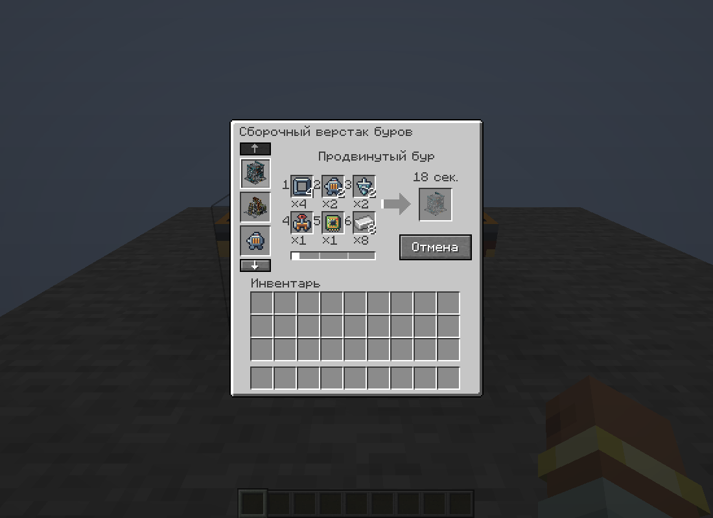
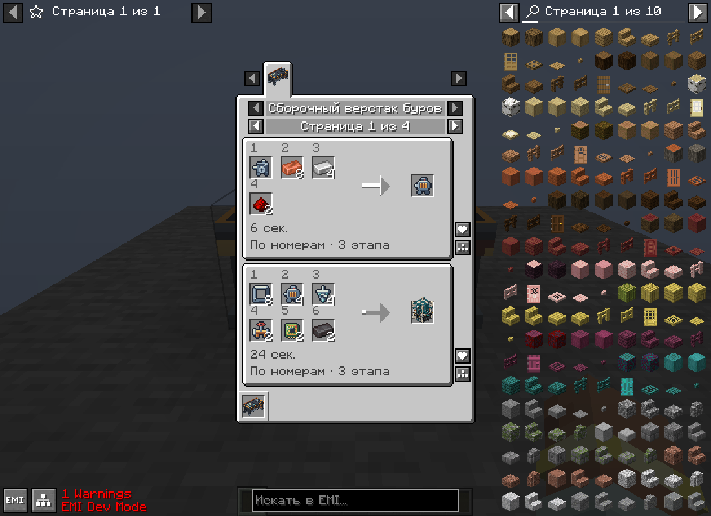
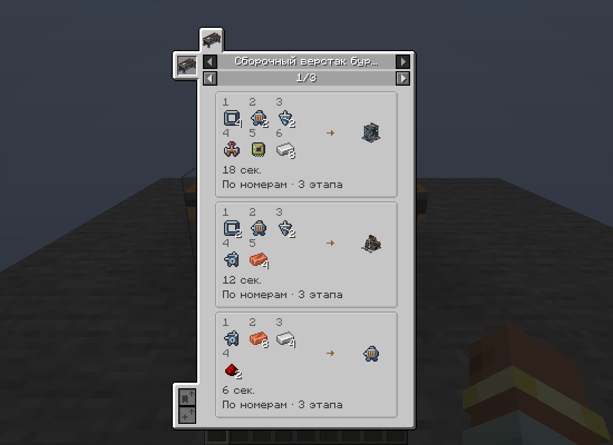
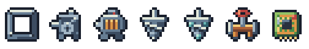

# Drill manufacturing

The assembly table manufactures the existing drills. Their dimensions, energy use, mining
speed, fluid mechanics, models and placement rules are unchanged.

| Equipment | Existing dimensions | Manufacture | Reason for the component choice |
| --- | --- | --- | --- |
| Burner mining drill | 2 × 2 × 2 | Ordinary crafting table | Frame, mechanical drive, head and furnace; no electrical materials |
| Exploration drill | One block | Assembly table, 10 s | Compact frame, motor, head, redstone instrumentation and viewing glass |
| Electric mining drill | 3 × 3 × 3 | Assembly table, 12 s | Two frames and heads, electric motor and a mechanical transmission |
| Advanced mining drill | 5 × 5 × 5 | Assembly table, 18 s | Reinforced cutting heads, two motors, fluid manifold and precision controls |
| Ultimate mining drill | 7 × 9 × 7 | Assembly table, 24 s | Larger modular frame and drive array, two fluid manifolds and netherite reinforcement |
| Seismic survey station | 3 × 3 × 3 | Assembly table, 20 s | 4 frames, 2 motors, 2 mechanical drives, a fluid manifold, precision control and an anvil as the impact mass |

Make the frame, mechanical drive and ordinary head at a crafting table. Make the assembly table
from a frame, iron and planks. The table makes motors, diamond-tipped heads, fluid manifolds
and precision controls as intermediate assemblies. Advanced machines reuse these components;
none of the recipes consume a previously built drill. No additional energy infrastructure is
needed to operate this manual assembly fixture.

The table occupies **two adjacent blocks (2 × 1 × 1)**. Placement reserves both cells and spends
one item. Both halves open the same inventory; breaking either removes the whole table and drops
one table item plus its contents. Pistons cannot separate the halves. The visual model is split at
the block boundary so both chunks render their own geometry.

Common materials use NeoForge `c:` convention tags: iron/copper/gold/netherite ingots,
iron nuggets, redstone dust, diamond/quartz gems and colorless glass blocks.
Wood uses `minecraft:planks`. Vanilla functional parts, such as pistons and comparators,
remain explicit ingredients. Every required tag has vanilla entries through NeoForge.

Iron rod: two vertically arranged iron ingots produce two rods. The drill head uses three ingots and two rods (`c:rods/iron`).

## Operating the table

1. Right-click the table and choose a blueprint by clicking its icon in the left column. Scroll the three visible slots with the top/bottom arrows or the mouse wheel. Block results are listed first, followed by component items.
2. Put the indicated counts into the ingredient slots. Empty fixtures show cycling ghost ingredients at 40% opacity;
   hover for the ingredient name and required count. Shift-click sends items to matching fixtures.
3. Leave unused fixtures empty and clear space in the output slot. Press **Assemble**.
4. The frame, installation and alignment/test phases appear in the interface. Actual components
   and then the resulting machine also appear on the worktop.
5. Take the finished output. Each button press produces one batch.

The empty output slot also shows a translucent result preview. Actual inserted materials and
the finished output render at full opacity; names and required counts remain readable.

Closing the interface does not stop assembly. Unloading the chunk or restarting the server
preserves progress and contents. Cancelling, selecting another blueprint or changing any inventory
slot stops the batch without spending its inputs. Breaking the table drops its inventory separately
from the table itself. Completion validates and consumes the ingredients on the server exactly once.
JEI and EMI both show the assembly recipes, counts, duration and table workstation.



The screen uses vanilla container styling: a light-gray beveled frame, recessed slots,
native Minecraft buttons and a filling progress arrow. Required counts,
ingredient tooltips and the three-part progress bar remain available. The recipe selector is integrated into the left side of the 196 × 215 panel. The editable texture source is
[`drill_assembly_interface.aseprite`](../assembly-sprites/drill_assembly_interface.aseprite).





## Datapack recipes

Assembly recipes use `ores_and_drills:drill_assembly`. `parts` is an ordered list of 1–6
counted ingredients; list entry zero belongs in fixture 1. Counts must be 1–64, and the
duration must be 20–12000 ticks. The result must fit in one normal item stack.

```json
{
  "type": "ores_and_drills:drill_assembly",
  "parts": [
    {"ingredient": {"item": "ores_and_drills:mechanical_drive"}, "count": 1},
    {"ingredient": {"tag": "c:ingots/copper"}, "count": 8},
    {"ingredient": {"tag": "c:ingots/iron"}, "count": 4},
    {"ingredient": {"tag": "c:dusts/redstone"}, "count": 2}
  ],
  "result": {"id": "ores_and_drills:electric_motor", "count": 1},
  "duration": 120
}
```

Recipes and their vanilla recipe-book unlocks are generated by `AssemblyRecipeProvider`.
Run `gradlew.bat runData` after changing the production chain and include the changed JSON files.
The former vanilla exploration-drill recipe now uses the assembly type under the same recipe ID.
This changes crafting progression in existing worlds, without converting placed machines or saves.
This feature does not change world generation or the format of existing drill block entities.
An old single-block assembly table expands automatically into the free cell to its right, preserving
its inventory, progress and front orientation. If that cell is occupied, the old table waits without
overwriting anything; clear the cell or break and replace the table. Its save data now records width 2.

## Art sources and checks

The table's editable Blockbench project is in [`../assembly-models`](../assembly-models).
Its 29 cuboids follow the [Minecraft Style Guide](https://www.blockbench.net/wiki/guides/minecraft-style-guide/):
simple geometry, deliberate pixel clusters and one texture pixel per model unit.
The 128 × 128 table atlas is painted in Aseprite against its actual per-face UV islands.
Blockbench MCP `check_model` reports zero UV, missing-texture or coplanar issues.

All seven components are **flat 16 × 16 item sprites**, painted in Aseprite with a consistent
top-left light source, cold blue-gray steel, orange copper and 6–13 colors per item.
The current sprites follow the user's latest seven-component reference: frontal mechanical forms,
an ink-navy 1px contour, separate steel gears, copper windings and a green control board.
They use `minecraft:item/generated`; the old component geometry and atlases have been removed.
During assembly the supplied components lie flat on the worktop. Source `.aseprite` files,
reproducible Aseprite Lua scripts are in [`../assembly-sprites`](../assembly-sprites).



Verification: `gradlew.bat spotlessApply spotlessCheck build runGameTestServer -PcompactGameTests
--console=plain`. `AssemblyGameTests` covers recipe availability and tags, JSON/network round trips,
counted consumption, single-batch concurrency, cancellation, blocked output, persistence, placement
in four directions, shared menus, blocked second cells, creative drops, cross-chunk cleanup and legacy expansion.
