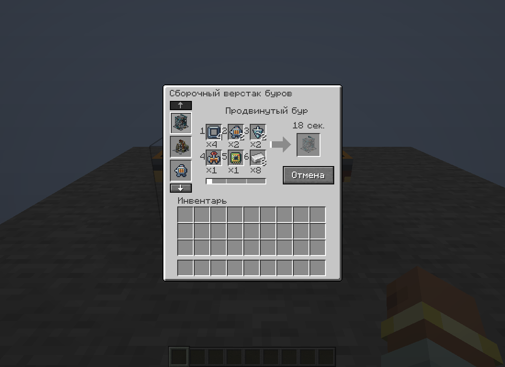
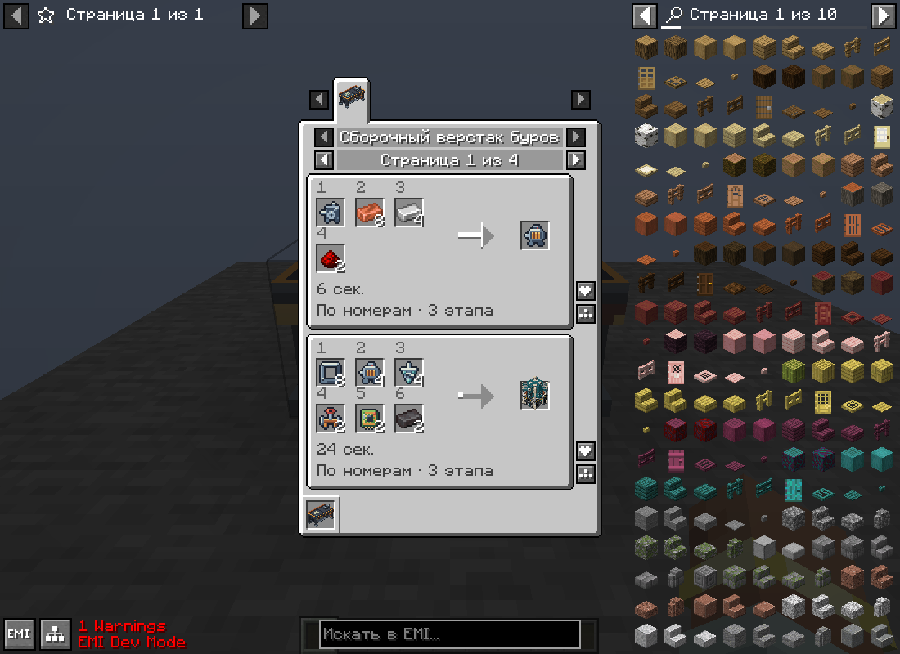
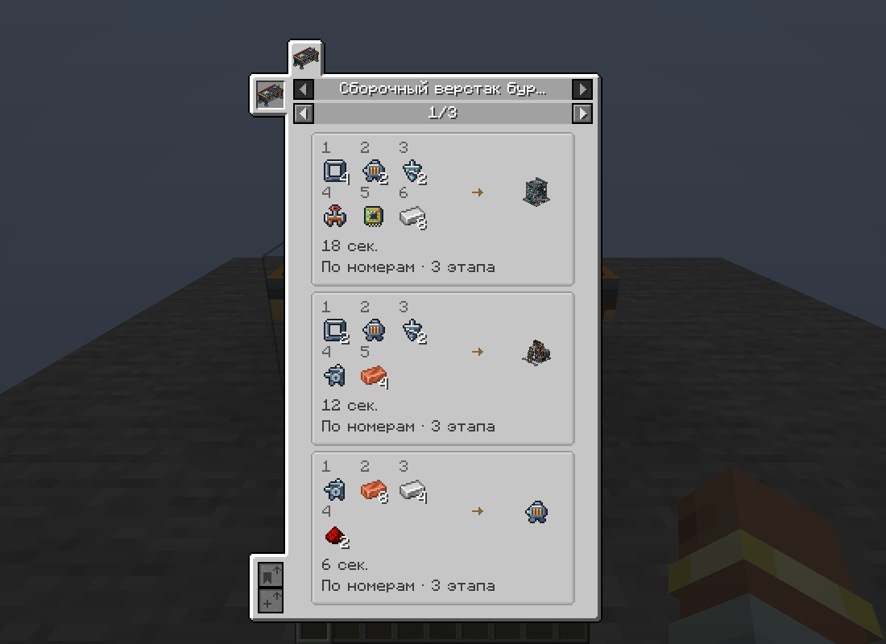
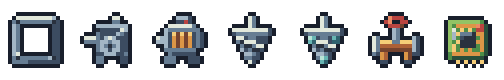

# Изготовление буров

Новая система изготавливает уже существующие буры. Их размеры, добыча, энергопотребление,
жидкостные механики, модели и правила установки не изменены.

| Оборудование | Существующие размеры | Изготовление | Основные узлы |
| --- | --- | --- | --- |
| Топливный бур | 2 × 2 × 2 | Обычный верстак | Рама, механический привод, головка и печь |
| Разведочный бур | Один блок | Сборочный стол, 10 с | Рама, электродвигатель, головка, редстоун и смотровое стекло |
| Электрический бур | 3 × 3 × 3 | Сборочный стол, 12 с | Две рамы и головки, двигатель и механический привод |
| Продвинутый бур | 5 × 5 × 5 | Сборочный стол, 18 с | Четыре рамы, два двигателя, алмазные головки, коллектор и управление |
| Максимальный бур | 7 × 9 × 7 | Сборочный стол, 24 с | Восемь рам, четыре двигателя и головки, два коллектора, управление и незеритовое усиление |
| Сейсмическая разведочная станция | 3 × 3 × 3 | Сборочный стол, 20 с | 4 рамы, 2 электромотора, 2 механических привода, жидкостный коллектор, узел точного управления и наковальня как ударная масса |

Сначала изготовьте раму, механический привод и обычную головку на обычном верстаке.
Из рамы, железа и досок соберите специальный верстак. На нём изготавливаются остальные узлы:
электродвигатель, алмазная головка, жидкостный коллектор и узел точного управления.
Готовые буры предыдущих уровней расходовать не нужно. Сборочный стол работает вручную,
без дополнительной энергетической инфраструктуры.

Стол занимает **два соседних блока (2 × 1 × 1)**. Обе позиции проверяются до расхода одного
предмета. Любая половина открывает общий инвентарь. Разрушение любой половины убирает весь стол;
выпадают один предмет стола и его содержимое. Поршни не разрывают конструкцию. Модель разделена
по границе блоков, поэтому соседние чанки отображают свою часть независимо.

Стандартные материалы принимаются через теги `c:ingots/iron`, `c:ingots/copper`,
`c:ingots/gold`, `c:ingots/netherite`, `c:nuggets/iron`,
`c:dusts/redstone`, `c:gems/diamond`, `c:gems/quartz`, `c:glass_blocks/colorless`
и `minecraft:planks`. Поршни, компараторы и другие функциональные детали Minecraft
указаны как конкретные предметы. Все необходимые теги работают без сторонних модов.

Железный стержень: два слитка железа друг над другом дают два стержня. Буровая головка требует три слитка и два стержня (тег `c:rods/iron`).

## Работа со столом

1. Откройте стол правой кнопкой и выберите чертёж нажатием на иконку в левой колонке. Три видимых слота прокручиваются стрелками сверху и снизу или колёсиком мыши. Сначала перечислена техника-блоки, затем предметы-компоненты.
2. Разместите указанное количество деталей в ячейках ингредиентов. В пустых ячейках видны
   образцы допустимых материалов с непрозрачностью 40%; подсказка показывает название и количество.
   Shift-клик переносит подходящие предметы в соответствующие ячейки.
3. Неиспользуемые ячейки оставьте пустыми, освободите выход и нажмите **Собрать**.
4. Пройдут монтаж рамы, установка узлов и настройка с проверкой. На столешнице
   последовательно появятся реальные детали и собираемая машина.
5. Заберите результат. Одно нажатие запускает одну сборку.

В пустой выходной ячейке также показан полупрозрачный образец результата. Положенные материалы
и готовый результат отображаются полностью непрозрачными; названия и количества остаются читаемыми.

Закрытие окна не останавливает работу. Содержимое и прогресс сохраняются при выгрузке
чанка и перезапуске сервера. Отмена, смена чертежа или изменение содержимого останавливает
сборку без расхода деталей. При разрушении стола его содержимое выпадает отдельно.
Детали проверяются и расходуются сервером только при завершении. JEI и EMI показывают
рецепты с количеством материалов, временем изготовления и сборочным столом.

Экран оформлен в стиле ванильных контейнеров: светло-серая рамка, углублённые ячейки,
обычные кнопки Minecraft и заполняющаяся стрелка. Нужное количество материалов,
подсказки и шкала с тремя делениями сохранены. Выбор рецепта встроен слева в общую панель 196 × 215. Исходник текстуры —
[`drill_assembly_interface.aseprite`](../assembly-sprites/drill_assembly_interface.aseprite).

## Настройка и разработка

Тип рецепта — `ores_and_drills:drill_assembly`. Список `parts` содержит от 1 до 6 элементов
с полями `ingredient` и `count`; порядок соответствует номерам ячеек. Количество — 1–64,
`duration` — 20–12000 тиков. `result` задаёт предмет и количество в пределах одного стака.
Полный JSON-пример приведён в [английском руководстве](../en/drill-assembly.md).

Рецепты и открытия книги рецептов создаёт `AssemblyRecipeProvider`; после изменения
запускайте `gradlew.bat runData` и включайте обновлённые JSON в изменения.
Старый рецепт разведочного бура заменён рецептом сборочного стола с прежним ID.
В существующих мирах меняется только изготовление оборудования: установленные буры,
формат их сохранений и генерация мира остаются прежними.

Старый одноблочный сборочный стол автоматически расширяется вправо, сохраняя ориентацию,
инвентарь и прогресс. Если соседняя позиция занята, расширение ждёт и ничего не перезаписывает:
освободите место либо разберите и установите стол заново. В сохранение самого стола добавлена ширина 2.

Стол создан через Blockbench MCP: 29 простых элементов, отдельные UV-участки граней и
атлас 128 × 128, нарисованный в Aseprite. Плотность — один пиксель на единицу модели.
Проверка Blockbench не находит ошибок UV, отсутствующих текстур или совпадающих граней.
Исходник модели находится в [`../assembly-models`](../assembly-models).

Семь компонентов полностью переведены в **плоские спрайты 16 × 16** с моделями
`minecraft:item/generated`. Они нарисованы в Aseprite по референсам пользователя и
[Minecraft Style Guide](https://www.blockbench.net/wiki/guides/minecraft-style-guide/):
свет сверху слева, холодная серо-синяя сталь, оранжевая медь, 6–13 цветов на предмет.
Текущие спрайты следуют последнему референсу семи деталей: фронтальный вид узлов,
тёмно-синий контур толщиной один пиксель, отдельные шестерни, обмотка и зелёная плата.
Старые объёмные модели и атласы деталей удалены; во время сборки предметы лежат на столешнице.
Редактируемые `.aseprite` и Lua-скрипты рисования в Aseprite находятся в
[`../assembly-sprites`](../assembly-sprites).

Проверки: `gradlew.bat spotlessApply spotlessCheck build runGameTestServer -PcompactGameTests
--console=plain`. `AssemblyGameTests` проверяет наличие рецептов и тегов, JSON и сетевую
сериализацию, точный расход, повторный запуск, отмену, блокировку выхода, сохранение, установку
в четырёх направлениях, общее меню, занятую соседнюю позицию, выпадение, границу чанков и расширение старых столов.
